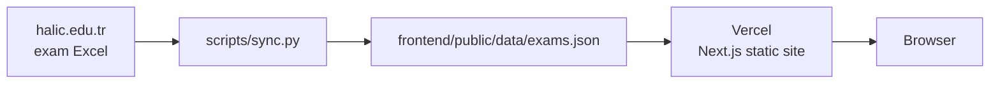

<div align="center">

# Haliç Exam Genius Pro

**Exam schedule app for Haliç University students.**

Pick your courses, see every exam's date, time and room, and export the schedule to your calendar or as an image. Turkish and English.

[halicexamgenius.app](https://www.halicexamgenius.app)


</div>

---

## Features

| Feature | Description |
|---|---|
| **Course search** | Search by code, name or acronym; `hlu` finds `HLÜ`. |
| **Sections** | Courses whose sections sit exams at different times are listed per section; program name is added when sections share a number. |
| **Exact times** | Dates and times are shown exactly as the university's Excel states them (Istanbul time), whatever the device time zone. |
| **Calendar export** | One `.ics` file with every selected exam (iOS, Android, Google, Outlook). |
| **Image export** | Schedule as a PNG, shared through the Web Share API where available. |
| **Bilingual** | Turkish and English, picked from the browser language. |
| **Dark mode** | Follows the system setting. |

---

## How it works

There is no backend. The university publishes the exam schedule as an Excel file; a script turns it into one static JSON file that the site loads.



`sync.py` handles the format quirks seen in past semesters (joined course codes, names containing `;`, renamed columns, time cells stored as text or as Excel times). Anything it does not recognise makes it fail without writing, so the last good data stays live.

---

## Getting started

**Prerequisites:** Node.js 22+, [uv](https://docs.astral.sh/uv/) (only for the sync script).

```bash
cd frontend
npm install
npm run dev        # http://localhost:3000
```

---

## Updating the schedule

When a new exam schedule is announced:

1. Put the "tüm liste" Excel link from the announcement on [halic.edu.tr](https://halic.edu.tr) into `scripts/source.url`.
2. Update the semester and exam type in `frontend/src/config/constants.ts`.
3. Open a pull request. CI downloads and parses the file and shows a summary (exam count, date range) so you can check it is the right one.

After merge, the sync workflow regenerates `exams.json` on `main`. It also runs every hour, so later edits to the same Excel are picked up. If the file can't be parsed, nothing is written and the last good data stays live.

To run it locally: `cd scripts && uv run sync.py` (or pass a downloaded file: `uv run sync.py <file>.xlsx`).

---

## Development

| Command | Where | What |
|---|---|---|
| `npm run lint` / `npm run format` | `frontend/` | Biome lint and format |
| `npm test` | `frontend/` | Date and calendar tests (`node:test`) |
| `uv run pytest` | `scripts/` | Excel parsing tests |

CI runs all of them on every pull request; the frontend tests run with `TZ=America/Los_Angeles` so time zone bugs can't hide behind an Istanbul machine.

---

## Project structure

```
halic-exam-genius-pro/
├── frontend/
│   ├── public/data/exams.json   # generated by scripts/sync.py
│   └── src/
│       ├── app/                 # Next.js app router
│       ├── components/          # UI components
│       ├── config/constants.ts  # semester and exam type labels
│       └── lib/                 # data loading, dates, ICS, i18n
├── scripts/
│   ├── source.url               # Excel link of the current exam period
│   ├── sync.py                  # Excel → exams.json
│   └── test_sync.py
└── .github/workflows/        # ci.yml, sync-data.yml
```

---

## License

[MIT](LICENSE)
